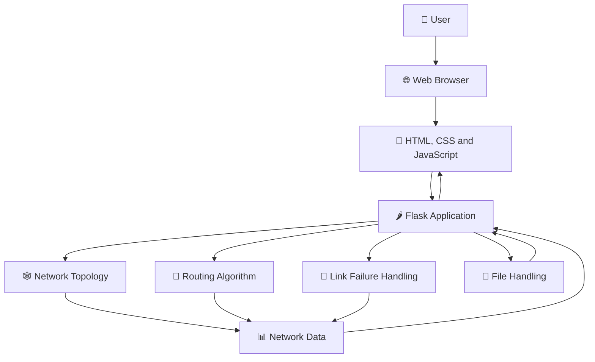
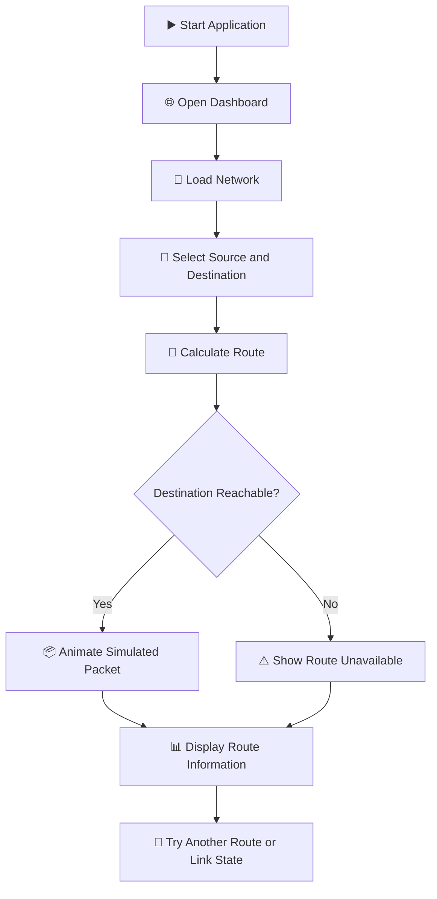
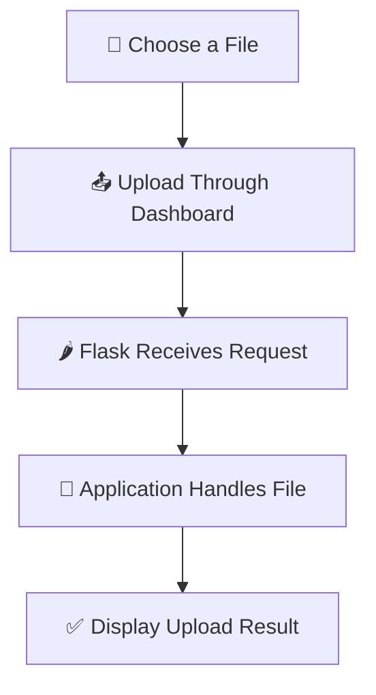
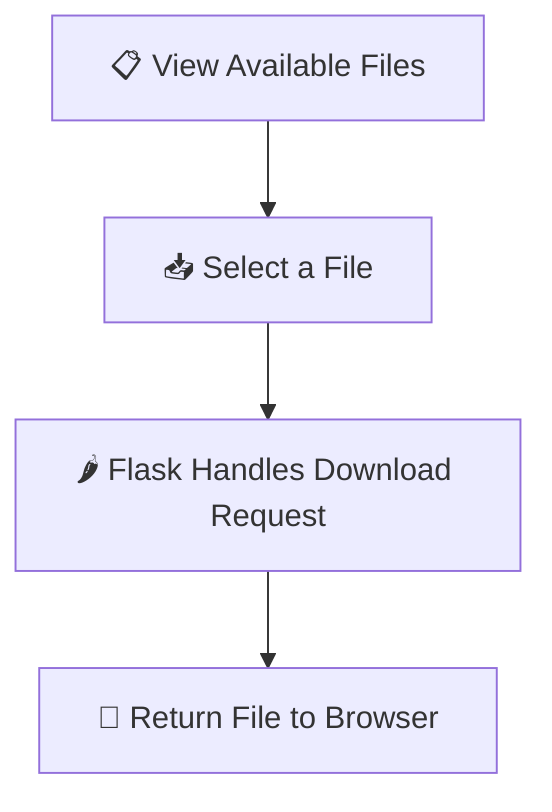

# 🌐 NetRoute — Network Topology and Routing Simulator

<p align="center">
  <strong>A Simple and Interactive Computer Networks Mini Project</strong>
</p>

<p align="center">
  
  
  
  
  
</p>

---

## 📌 1. About the Project

**NetRoute** is a web-based network topology and routing simulator developed using Python, Flask, and NetworkX.

It helps students understand how routers connect to each other, how data can travel through a network, and how a routing algorithm finds a path from a sender to a destination.

The project provides a visual dashboard where users can explore network topologies, select routers, simulate packet movement, and experiment with network links. It also includes file upload and download functionality.

Instead of working only with theoretical diagrams, users can interact with a simulated network through a web browser.

### 🎯 Main Goal

To demonstrate important Computer Networks concepts through a simple, visual, and interactive application.

## ✨ 2. Key Features

| Feature | Description |
|---|---|
| 🖥️ Interactive dashboard | View and interact with the network through a web interface. |
| 🔗 Network topologies | Explore different ways of connecting routers. |
| 🧭 Shortest-path routing | Find a route between a source router and a destination router. |
| 📦 Packet animation | Visualize a simulated packet travelling along a selected route. |
| 🚦 Link failure simulation | Disable or restore a network link to study its effect. |
| 📁 File upload | Upload files through the web application. |
| 📥 File download | Download files made available by the application. |
| 📊 Network visualization | View routers, connections, and routing information. |
| 🧪 Automated testing | Run tests to check important network functions. |
| 🌍 Web deployment | Deploy the application so it can be accessed through a public URL. |

## 🛠️ 3. Technologies Used

| Technology | Purpose |
|---|---|
| 🐍 Python | Implements the network logic and application backend. |
| 🌶️ Flask | Creates the web application and handles HTTP requests. |
| 🕸️ NetworkX | Represents the network as a graph and supports graph algorithms. |
| 🌐 HTML | Structures the web page. |
| 🎨 CSS | Controls the dashboard's appearance, layout, and styling. |
| ⚡ JavaScript | Handles interactive dashboard behavior and visual animations. |
| 🧪 pytest | Runs automated tests. |
| 🐙 Git and GitHub | Track project changes and store the source code online. |
| 🚀 Gunicorn | Runs the Flask application in a production hosting environment. |

## 🏗️ 4. System Architecture

NetRoute follows a simple web application architecture. The browser displays the dashboard, Flask handles requests, and the network modules perform the routing and simulation logic.



### 🔍 How the Architecture Works

1. **User interface:** The user opens the dashboard and selects an operation.
2. **Frontend:** HTML, CSS, and JavaScript display the network and handle user interactions.
3. **Flask backend:** The server receives requests and calls the appropriate Python functions.
4. **Topology module:** Creates and manages network graphs.
5. **Routing module:** Calculates the route between selected routers.
6. **Failure module:** Supports disabling and restoring links.
7. **File handling:** Manages the application's file upload and download features.
8. **Response:** The server returns the result for the dashboard to display.

*Note: The packet animation represents simulated network traffic. File uploads and downloads are handled by the web application; they are not automatically transmitted through the simulated router path.*

## 📂 5. Project Structure

```text
NetRoute/
│
├── network/
│   ├── topology.py       # Creates network topologies
│   ├── addressing.py     # Network addressing functions
│   ├── routing.py        # Finds routes between routers
│   └── failures.py       # Handles link failures
│
├── tests/
│   ├── test_topology.py  # Tests topology functions
│   ├── test_addressing.py
│   ├── test_routing.py   # Tests routing functions
│   └── test_failures.py  # Tests link failure functions
│
├── templates/
│   └── index.html        # Web dashboard
│
├── app.py                # Flask application
├── main.py               # Main project entry point
├── requirements.txt      # Python dependencies
├── .gitignore            # Files excluded from Git
└── README.md             # Project documentation
```

### 📘 Important Files

- **`app.py`** — connects the web interface with the Python backend.
- **`main.py`** — provides the main project entry point.
- **`topology.py`** — creates the network graph and its connections.
- **`routing.py`** — calculates the shortest path between routers.
- **`failures.py`** — manages disabled and restored links.
- **`addressing.py`** — contains network addressing functionality.
- **`index.html`** — contains the dashboard interface.
- **`requirements.txt`** — lists the Python packages needed by the project.
- **`tests/`** — contains automated tests for core functionality.

## 🔗 6. Network Topologies

A network topology describes how devices such as routers are connected.

NetRoute includes functions for creating the following topology types.

### ⭐ Star Topology

<details>
<summary>Click to learn about star topology</summary>

In a star topology, every outer device connects to a central device.

**Advantages**
- Easy to manage and troubleshoot.
- A single outer-link failure usually affects only its connected device.

**Disadvantages**
- The central device can become a single point of failure.

</details>

### 🔄 Ring Topology

<details>
<summary>Click to learn about ring topology</summary>

In a ring topology, each router connects to neighboring routers in a circular arrangement.

**Advantages**
- Provides an organized connection structure.
- Can offer an alternative route when suitable links remain available.

**Disadvantages**
- A link failure can interrupt connectivity in a simple ring unless another route is available.

</details>

### 🕸️ Mesh Topology

<details>
<summary>Click to learn about mesh topology</summary>

In a mesh topology, routers have multiple connections to other routers.

**Advantages**
- Can provide alternative paths.
- Helps demonstrate route selection and link failure recovery.

**Disadvantages**
- Requires more connections as the number of routers increases.

</details>

The exact topology displayed depends on the topology selected in the application.

## 🧭 7. Routing Algorithm

Routing determines the path that data should take from a source to a destination.

NetRoute represents routers as **nodes** and network connections as **edges**. Each edge can have a cost, which represents the relative cost of using that connection.

The routing module uses NetworkX to calculate a shortest path.

### 🧮 Example Network

The sample network contains these connections:

| Connection | Cost |
|---|---:|
| R1 — R2 | 2 |
| R1 — R3 | 5 |
| R2 — R3 | 1 |
| R2 — R4 | 4 |
| R3 — R4 | 2 |

Suppose the source is **R1** and the destination is **R4**.

The possible route through R2 and R3 has this total cost:

`R1 → R2 → R3 → R4`

Total cost = 2 + 1 + 2 = **5**

The direct alternative through R2 has a cost of 2 + 4 = **6**.

Therefore, the route through R3 has the lower total cost.

The routing function returns information about the source, destination, path, total cost, and whether the destination is reachable.

**Why is this useful?**

Shortest-path routing helps demonstrate how a network can select a route based on link costs rather than simply choosing the route with the fewest visible connections.

## 🔁 8. Application Workflow

The following diagram shows the main routing workflow.



### Step-by-Step Explanation

1. Start the Flask application.
2. Open the dashboard in a browser.
3. Select a network topology.
4. Choose a source router and destination router.
5. Request a route calculation.
6. The backend checks the network and calculates a path.
7. If a path exists, the dashboard can visualize packet movement.
8. If no path exists, the application can report that the destination is unreachable.
9. Repeat the process after changing the route or network links.

## 🚦 9. Link Failure Simulation

Real networks can experience failures caused by damaged cables, disconnected devices, or faulty interfaces.

NetRoute includes functions for disabling and enabling network links.

### 🔴 When a Link Is Disabled

- The selected connection is made unavailable to the routing logic.
- The network's connectivity may change.
- A previously available route may become unavailable.
- The route calculation can be repeated to examine the effect.

### 🟢 When a Link Is Restored

- The connection is made available again.
- The network can be checked for a usable route.
- The shortest path may return to its previous value.

This feature demonstrates the importance of network reliability and alternative routes.

## 📁 10. File Upload and Download

NetRoute also provides file upload and download functionality through its web application.

### Upload Workflow



### Download Workflow



These features demonstrate basic file transfer through a web application. They do not, by themselves, implement a real router-by-router file transfer protocol.

**Security note:** A production deployment should validate filenames and file types, limit upload sizes, restrict access to uploaded files where appropriate, and avoid exposing private files.

## ⚙️ 11. Installation and Setup

Follow these instructions to run NetRoute on your local computer.

### Prerequisites

Install the following software:

- Python
- Visual Studio Code or another code editor
- Git (optional for cloning and version control)
- A modern web browser

### Step 1: Clone the Repository

Replace `YOUR-USERNAME` with your GitHub username.

```bash
git clone https://github.com/YOUR-USERNAME/NetRoute.git
cd NetRoute
```

If the project is already on your computer, open its existing folder instead.

### Step 2: Create a Virtual Environment

```bash
python -m venv .venv
```

A virtual environment keeps this project's Python packages separate from other projects.

### Step 3: Activate the Virtual Environment

**Windows PowerShell:**

```powershell
.\.venv\Scripts\Activate.ps1
```

If PowerShell blocks activation, follow the official Python or Microsoft guidance for your system rather than changing security settings unnecessarily.

### Step 4: Install Dependencies

```bash
python -m pip install -r requirements.txt
```

This installs the packages listed in `requirements.txt`.

### Step 5: Start the Application

```bash
python app.py
```

If your project instructions use a different entry point, use the command appropriate for that entry point.

Open the local URL printed by Flask in your terminal. For a standard local configuration, this is often:

`http://127.0.0.1:5000`

Keep the terminal running while you use the application.

## 🧪 12. Running the Tests

NetRoute includes automated tests for important network operations.

Run the following command from the project directory:

```bash
python -m pytest -v
```

The tests cover areas such as:

- Network topology creation.
- Network addressing.
- Route calculation.
- Link failure handling.

**Development test result:** 14 tests passed during development. Run the command above to verify the result in your current environment.

Automated tests help catch errors early and make it easier to maintain the project as new features are added.

## 🖥️ 13. How to Use the Dashboard

Once the application is running:

1. Open the dashboard in your browser.
2. Select an available network topology.
3. Choose the source router.
4. Choose the destination router.
5. Start the route simulation.
6. Observe the selected path and packet animation.
7. Review the route information displayed by the application.
8. If supported by the dashboard controls, experiment with link failures and restored connections.
9. Use the file section to upload or download files.

The exact controls and displayed information depend on the current dashboard implementation.

## 🚀 14. Deployment

NetRoute can be deployed to a hosting service such as Render so other people can access it through a public URL.

A typical deployment uses:

- **Source repository:** GitHub
- **Web framework:** Flask
- **Production server:** Gunicorn
- **Build or installation command:** `pip install -r requirements.txt`
- **Start command:** `gunicorn app:app`

The start command assumes that `app.py` contains a Flask application object named `app`.

### Important Deployment Notes

- Configure debug mode off in production.
- Never commit passwords, API keys, or other secrets.
- Check the hosting service's filesystem rules before relying on uploaded files being stored permanently.
- Temporary or ephemeral storage may be cleared during a restart or redeployment.
- Configure persistent storage or an external file-storage service if permanent file retention is required.
- Test file upload and download functionality after deployment.

## ⚠️ 15. Project Scope and Limitations

NetRoute is an educational simulator. It is designed to demonstrate network concepts, not to replace real networking equipment or production routing software.

Current scope includes graph-based network simulation, shortest-path calculations, link failure handling, a visual dashboard, and web-based file operations.

Unless separately implemented, the project does not provide:

- Real router configuration or hardware control.
- Actual IP packet forwarding through physical routers.
- A complete implementation of a production routing protocol such as OSPF or BGP.
- Guaranteed permanent storage of uploaded files on temporary hosting.
- A security audit or production-grade file-sharing system.

These distinctions are important when presenting the project in a viva or technical demonstration.

## 🔮 16. Future Enhancements

Possible future improvements include:

- 📡 Simulate packet loss, latency, and bandwidth.
- 🧠 Add more routing algorithms for comparison.
- 🔐 Add authentication and access control.
- 📈 Add more network performance metrics.
- 🧪 Expand automated test coverage.
- 🗃️ Add persistent storage for shared files.
- 📱 Improve the dashboard for mobile devices.
- 🛡️ Add more robust file validation and security controls.
- 🌍 Add deployment automation and continuous integration.

These are potential enhancements, not claims that all of them are currently implemented.

## 🎓 17. Learning Outcomes

This project helps demonstrate the following concepts:

- Understanding nodes, edges, and network graphs.
- Learning how network topologies differ.
- Understanding shortest-path routing.
- Exploring link costs and route selection.
- Observing how failures can affect connectivity.
- Connecting a Python backend to a browser-based interface.
- Using automated tests to verify software behavior.
- Managing source code with Git and GitHub.
- Understanding basic web application deployment.

## 👨‍💻 18. Academic Project Information

**Project name:** NetRoute — Network Topology and Routing Simulator

**Project type:** Computer Networks Mini Project

**Primary language:** Python

**Framework:** Flask

**Graph library:** NetworkX

**Testing framework:** pytest

**Developed for:** Computer Networks learning and demonstration

**Developer:** Add your name here.

**Institution:** Add your college or university here.

**Academic year:** Add your academic year here.

## 📜 19. License

If you intend to share or reuse this project publicly, add a license file that matches the permissions you want to grant. Until a license is selected and added, do not assume that the repository grants unrestricted reuse.

## ✅ Conclusion

NetRoute combines network topology visualization, shortest-path routing, link failure simulation, and web-based file handling in one application.

It provides a practical way to explore how network connections affect routing decisions and how Python can be used to build an interactive Computer Networks learning tool.

**Explore the topology. Calculate the route. Simulate the network.** 🌐

