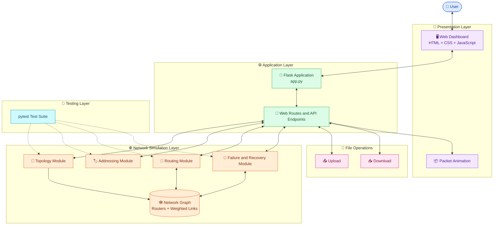

# 🌐 NetRoute — Network Topology & Routing Simulator

<p align="center">
  <strong>An Interactive Computer Networks Mini-Project</strong><br>
  Visualize network topologies, calculate shortest routes, simulate link failures, and explore file transfer through a web dashboard.
</p>

<p align="center">
  
  
  
  
  
  
</p>

---

## 📌 1. Introduction

**NetRoute** is a web-based network topology and routing simulator developed as a Computer Networks mini-project using Python, Flask, and NetworkX.

The project represents a computer network as a graph consisting of routers and weighted connections. Users can select a network topology, choose a sender and destination, calculate the shortest path, and observe an animated packet moving along the selected route.

The application also includes network link failure and recovery functionality, along with file upload and download through the web interface.

The goal is to make important networking concepts easier to understand through interactive visualization.

## 🎯 2. Project Objectives

- 🧩 Represent a computer network using graph structures.
- 🌐 Visualize routers and connections between them.
- 🧭 Calculate the minimum-cost route between two routers.
- 📦 Animate packet movement along a selected route.
- 🔌 Demonstrate network link failure and recovery.
- 📤 Support file upload and download through the application.
- 🖥️ Provide an interactive web-based dashboard.
- 🧪 Validate core functionality through automated tests.

## ✨ 3. Key Features

| Feature | Description |
|---|---|
| 🌐 Topology selection | Sample, star, ring, and mesh network models |
| 🧭 Shortest-path routing | Finds a minimum-cost path using NetworkX |
| 📦 Packet animation | Visualizes movement from source to destination |
| 🔌 Failure simulation | Supports disabling and restoring network links |
| 📁 File operations | Uploads and downloads files through the web application |
| 🖥️ Dashboard | Interactive browser-based interface |
| 🧪 Unit testing | Tests topology, addressing, routing, and failure modules |
| 🧱 Modular design | Separates application logic into Python modules |

## 🛠️ 4. Technology Stack

<p>
  
  
  
  
  
  
  
</p>

| Technology | Role in the project |
|---|---|
| Python | Core application logic |
| Flask | Web server and request handling |
| NetworkX | Graph modeling and shortest-path calculations |
| HTML | Dashboard structure |
| CSS | Layout, styling, and visual effects |
| JavaScript | Interactive controls and packet animation |
| pytest | Automated testing |
| Git | Version control |
| GitHub | Source code repository |
| Render | Planned hosting platform |

## 🏗️ 5. System Architecture

NetRoute uses a modular architecture that separates the user interface, web application, network functionality, and testing.

### Architecture diagram



### Architecture explanation

**1. Presentation layer — `templates/index.html`**

Provides the browser interface, topology controls, sender and destination selection, route display, and animation. CSS controls appearance, while JavaScript handles interactive behavior.

**2. Application layer — `app.py`**

Runs Flask and connects browser requests to the network modules and file operations.

**3. Topology module — `network/topology.py`**

Creates the sample, star, ring, and mesh network graphs.

**4. Addressing module — `network/addressing.py`**

Contains the network addressing logic used by the project.

**5. Routing module — `network/routing.py`**

Calculates a shortest route between routers using weighted graph edges.

**6. Failure module — `network/failures.py`**

Provides functionality for disabling links, restoring links, and working with the active network.

**7. File operations**

The web application processes uploaded files and provides available files for download. The simulated packet animation is a visualization; it does not by itself prove that uploaded bytes travel through the simulated routers.

**8. Testing layer — `tests/`**

Contains automated tests for the main network modules.

### 🔄 Request flow

1. The user selects a topology, sender, and destination.
2. The browser sends a request to the Flask application.
3. The application obtains the selected network graph.
4. The routing module calculates the shortest route.
5. The result is returned to the browser.
6. The dashboard displays the route and animates packet movement.
7. File uploads and downloads are processed through the web application.

## 📂 6. Project Structure

```text
NetRoute/
│
├── 📁 network/
│   ├── topology.py       # Creates network topologies
│   ├── addressing.py     # Network addressing logic
│   ├── routing.py        # Shortest-path routing
│   └── failures.py       # Link failure and recovery
│
├── 📁 tests/
│   ├── test_topology.py
│   ├── test_addressing.py
│   ├── test_routing.py
│   └── test_failures.py
│
├── 📁 templates/
│   └── index.html        # Web dashboard
│
├── app.py                # Flask application
├── main.py               # Command-line demonstration
├── requirements.txt      # Python dependencies
├── .gitignore            # Excluded files
└── README.md             # Project documentation
```

## 🌐 7. Network Topologies

A network topology describes how routers or devices are interconnected.

### 🟣 Sample topology

The original sample graph contains four routers and five weighted connections.

| Connection | Cost |
|---|---:|
| R1 — R2 | 2 |
| R1 — R3 | 5 |
| R2 — R3 | 1 |
| R2 — R4 | 4 |
| R3 — R4 | 2 |

These costs are abstract routing weights, not necessarily real-world latency or physical distance.

### 🔵 Star topology

All outer routers connect to a central router.

**Advantages**
- Simple to understand.
- Easy to manage.
- Individual outer-link failures can be isolated.

**Disadvantage**
- Failure of the central router can disconnect the network.

### 🟢 Ring topology

Routers are connected in a closed loop.

**Advantages**
- Structured connection pattern.
- An alternative direction around the ring may remain available after a link failure.

**Disadvantage**
- Connectivity depends on which links remain operational.

### 🟠 Mesh topology

Routers have multiple connections to other routers.

**Advantages**
- Multiple possible routes.
- Can provide resilience through alternative paths.

**Disadvantages**
- Requires more connections.
- The graph becomes more complex as the network grows.

## 🧭 8. Shortest-Path Routing

NetRoute represents the network as a weighted graph. Each router is a node, and each connection is an edge with a cost.

The routing module uses NetworkX to find a minimum-cost path between the source and destination.

### Cost calculation

\[
C(P)=\sum_{e\in P} w(e)
\]

Where:

- \(P\) is a path through the network.
- \(e\) is a connection along that path.
- \(w(e)\) is the connection's weight.
- \(C(P)\) is the total path cost.

### Worked example: R1 to R4

**Path A:** R1 → R2 → R4

Cost = 2 + 4 = **6**

**Path B:** R1 → R3 → R4

Cost = 5 + 2 = **7**

**Path C:** R1 → R2 → R3 → R4

Cost = 2 + 1 + 2 = **5**

Therefore, the minimum-cost route is:

**R1 → R2 → R3 → R4**

**Total cost: 5**

The implementation is located in `network/routing.py`, in `find_shortest_route()`.

## 🔌 9. Link Failure and Recovery

Network connections can fail because of physical damage, hardware issues, or configuration errors.

NetRoute provides functions to disable and restore network links.

### Failure workflow

1. A network link is disabled.
2. The active network changes to reflect the unavailable connection.
3. Routing can be evaluated against the remaining network.
4. The application can determine whether a route remains available.

### Recovery workflow

1. The failed link is restored.
2. The connection becomes available again.
3. The network can be evaluated in its recovered state.

This feature demonstrates network connectivity, alternative routes, and resilience. An alternative route is only available when the remaining graph supports one.

## 📤 10. File Upload and Download

NetRoute provides file operations through its web interface.

### Upload process

1. Select a file in the dashboard.
2. Submit the file to the Flask application.
3. The server processes the uploaded file.
4. The interface displays the upload result.

### Download process

1. Select an available file.
2. Request the file through the application.
3. The server returns the file for download.

### Important distinction

The file upload and download functionality is real web-server functionality, while the sender-to-destination packet movement is a routing visualization unless the application explicitly connects the file's bytes to the simulated network.

For public deployment, file size limits, filename validation, persistent storage, and access controls should be considered.

## ⚙️ 11. Installation and Setup

### Prerequisites

- Python 3.14 or another compatible Python version.
- Git.
- A code editor such as Visual Studio Code.
- A modern browser.

### Step 1 — Clone the repository

Replace `YOUR-USERNAME` with your GitHub username.

```bash
git clone https://github.com/YOUR-USERNAME/NetRoute.git
cd NetRoute
```

### Step 2 — Create a virtual environment

On Windows:

```powershell
python -m venv .venv
```

### Step 3 — Activate it

```powershell
.\.venv\Scripts\Activate.ps1
```

If PowerShell blocks activation in the current session:

```powershell
Set-ExecutionPolicy -Scope Process -ExecutionPolicy Bypass
.\.venv\Scripts\Activate.ps1
```

### Step 4 — Install dependencies

```powershell
python -m pip install -r requirements.txt
```

### Step 5 — Run the tests

```powershell
python -m pytest -v
```

## ▶️ 12. Running NetRoute

### Start the web application

```powershell
python app.py
```

Open the local URL shown by Flask. In the development setup, it is:

**http://127.0.0.1:5000**

Keep the terminal running while using the dashboard.

### Run the command-line demonstration

```powershell
python main.py
```

## 🧪 13. Testing

The project uses pytest to test its core modules.

```powershell
python -m pytest -v
```

Test files:

- `tests/test_topology.py`
- `tests/test_addressing.py`
- `tests/test_routing.py`
- `tests/test_failures.py`

**Development test result:** 14 tests were reported as passing during development.

These tests validate the cases they cover. They do not automatically guarantee that every browser feature or cloud deployment scenario works.

## 🖥️ 14. Dashboard Usage

1. Start the Flask application.
2. Open the dashboard.
3. Select a network topology.
4. Choose the sender and destination.
5. Start the route simulation.
6. Observe the packet animation and route result.
7. Upload a small test file.
8. Download an available file.
9. Test failure and recovery controls if they are exposed in the interface.

For the original sample topology, R1 to R4 should have a shortest-path cost of 5 if the example edge weights are unchanged.

## 🚀 15. Deployment

The project can be deployed on a Python-compatible hosting platform such as Render.

Before deployment:

- Ensure `requirements.txt` contains the required runtime dependencies.
- Confirm that the repository includes all source files.
- Configure the platform to install dependencies.
- Configure a production web-server command appropriate for the deployment platform.
- Test the deployed routes, dashboard, uploads, and downloads.
- Configure persistent storage if uploaded files must survive service restarts or redeployments.

**Storage note:** A local folder on a hosted instance may be temporary. Do not assume uploaded files will persist unless the hosting platform and application are configured to retain them.

## ⚠️ 16. Limitations

- The network is simulated using a graph rather than physical routers.
- Connection costs are abstract weights.
- Packet animation visualizes a route; it is not proof of real packet forwarding.
- File upload and download are handled by the web application.
- Persistent storage and multi-user access depend on server configuration.
- The application is an educational project, not a production-grade networking platform.

## 🔮 17. Future Enhancements

Potential improvements include:

- 📊 Live charts for route cost and transfer progress.
- ⏱️ Latency and throughput measurements.
- 📉 Packet loss simulation.
- 🔁 Automatic route recalculation after failures.
- 🔐 Authentication and controlled file sharing.
- ☁️ Persistent cloud storage.
- 📱 Improved mobile responsiveness.
- 🧪 Additional integration and end-to-end tests.
- 🌍 Deployment with production security settings.

## 🎓 18. Learning Outcomes

This project provides practical experience with:

- Computer network topology concepts.
- Graph modeling and weighted routing.
- Shortest-path algorithms.
- Network failure and recovery.
- Python modular programming.
- Flask web development.
- Interactive HTML, CSS, and JavaScript.
- File handling.
- Automated testing with pytest.
- Version control with Git.
- Source hosting and cloud deployment.

## 🏁 Conclusion

NetRoute demonstrates important Computer Networks concepts through an interactive web-based simulator. It combines network topology visualization, shortest-path routing, link failure and recovery, packet animation, and file handling.

The modular design makes the project easier to test, explain, and extend. It provides a foundation for further exploration of routing algorithms, network resilience, and interactive network simulation.

---

<p align="center">
  <strong>NetRoute — Explore Networks. Understand Routing. Visualize Connectivity.</strong>
</p>

<p align="center">
  <sub>Computer Networks Mini-Project</sub>
</p>
